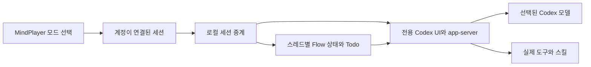

# MindPlayer Flow 시스템 설계

상태: 기본 Flow는 0.58.0, 기존 세션의 모드 전환은 0.59.0에 구현했고 0.59.1은 Jev의 사용자가 선택한 Terra baseline 처리 오류를 수정했다. 화면 기준은 [1안 시안](2026-10-27-omp-mode-gallery.ko.html)과 [기존 세션 시안](2026-10-27-existing-session-flow.ko.html)이다. Flow는 OMP의 모든 명령과 화면을 복제하지 않는다.

## 목표

Flow는 OMP 프로그램을 실행하는 기능이 아니다. MindPlayer에서 실제 Codex 계정과 세션을 열되, OMP에서 관찰한 작업 방식과 화면을 Codex의 실행 모델에 맞게 구현하는 모드다. 기존 Codex 모드는 그대로 둔다. OMP의 내부 도구 이름을 Codex에서 쓸 수 있는 것처럼 표시하지 않는다.

| 관심사 | Flow의 책임 | 실제 원천 |
|---|---|---|
| 입장과 재개 | 계정 선택 뒤 Codex 또는 Flow를 명시적으로 선택하고 세션별 모드를 보존한다. | MindPlayer 계정·세션 상태, Codex가 확인한 스레드 ID |
| 행동 지침 | 탐색·구현·검증을 이어가는 지침을 기존 Codex 지침에 **추가**한다. | 전용 Codex 런타임에서 해석된 지침과 Flow 정책 |
| 대화와 도구 | 답변, 실행 중인 작업, 도구 호출·결과를 실제 이벤트로 보여준다. | Codex app-server와 해당 스레드의 이벤트 |
| Todo | 단계와 작업, 진행·완료·차단 상태를 실제 작업 목록에서 보여준다. | Flow의 모델 호출 가능 도구와 스레드별 저장 상태 |
| 스킬과 에이전트 | 설치된 스킬의 지침과 실제 위임된 에이전트를 구분한다. | Codex가 발견한 스킬과 실제 에이전트 상태 |
| 모델과 계획 | 모델·사고 수준은 실제 설정을, 계획은 실제 Codex 계획을 보여준다. | Codex 모델 목록과 적용된 설정·계획 이벤트 |

## 실행 경계

MindPlayer는 계정 선택, 화면 구성과 세션을 소유한다. 전용 Codex 런타임은 원래의 모델 호출과 권한, 네이티브 도구, 스킬 발견, 에이전트 실행, 입력 큐를 계속 소유한다. 로컬 중계는 두 쪽의 확인된 스레드와 이벤트를 연결한다. Jev는 별개 선택이며, Flow를 켰다는 이유로 Jev 또는 외부 프롬프트 전송을 켜지 않는다.

현재 구현은 Codex에 추가 지침과 Todo 도구를 제공하는 방식이다. OMP의 자체
시스템 프롬프트 구성, 도구 실행기, 스킬 로더와 에이전트 실행 루프를 그대로
실행하지 않으므로 OMP와 동등한 작업 행동을 보장하지 않는다. 프로젝트 메모리와
승인 규칙도 기존 Codex 세션에 그대로 적용된다.

## 지침과 권한

- Codex의 기본 지침, 사용자가 설정한 지침, 프로젝트 `AGENTS.md`, 스킬 및 네이티브 Plan 모드를 먼저 보존한다. Flow는 확인된 해당 스레드에서 별도 지침을 추가한다.
- Codex의 `baseInstructions`, `developerInstructions` 또는 Plan 모드 지침을 Flow 문자열로 교체하지 않는다. 이 필드는 기존 값을 덮어쓸 수 있다.
- Flow 지침은 실제 제공되는 도구와 스킬만 사용하게 한다. 다단계 작업은 실제 Todo를 만들고, 수행·완료·차단 사실을 확인한 경우에만 상태를 바꾼다.
- 지침은 보안 경계가 아니다. 기존 승인·샌드박스 설정을 변경하거나 추가 승인 단계가 있는 것처럼 표시하지 않는다. 기존 MindPlayer Codex 실행은 `never` 승인과 `danger-full-access`를 명시하므로, 별도 변경 없이 안전한 샌드박스라고 주장하지 않는다.
- 사용자 전역 Codex 설정이나 인증 정보를 Flow 설정으로 덮어쓰지 않는다.

## 스레드와 재개

Flow는 창 전체의 장식이 아니라 **계정과 실제 Codex 스레드에 연결된 모드**다. 새 창의 임시 ID, 현재 작업 폴더, 시간이나 제목만으로 소유권을 추측하지 않는다. 서버의 정상 응답과 계정 소유권이 확인된 다음에만 모드와 UI를 연결하며, 확인이 실패하면 기존 세션에 Flow 정책을 잘못 적용하지 않는다.

- 새 세션: 명시적 Flow 선택을 보관하고 실제 생성된 스레드의 확인 결과와 연결한다.
- 재개: 이전에 선택한 창의 모드가 아니라 재개 대상 스레드의 계정별 저장 상태를 사용한다.
- 분기: 확인된 원본의 상태를 확인된 새 스레드에 연결한다. 원본 대화는 유지한다.
- `/clear`: 확인된 연결 관계가 있는 새 스레드에만 연속성을 적용한다. 재개나 분기를 `/clear`로 추측하지 않는다.
- 늦게 도착한 응답, 실패, 임시 스레드 또는 다른 계정의 스레드는 소유권의 증거가 아니다.

### 기존 세션의 모드 전환

- 목록에서 종료된 Codex 세션을 선택하고 `f`를 누른 뒤 Native 또는 Flow를 선택한다. `Esc`는 취소하며 일반 `Enter`는 이전 모드를 유지한다. 실행 중이거나 작업 중인 세션과 다른 에이전트는 전환하지 않는다.
- 대상 세션 ID와 계정 슬롯을 선택 시 고정하고, 비동기 계정 확인 후 다시 검사한다. 계정이 미연결인 경우 사용자가 기존 계정 확인 화면에서 명시적으로 연결해야 계속한다. 전환은 대화 파일을 수정하거나 새 스레드를 만들지 않는다.
- 로컬 중계는 실제 app-server의 이메일·워크스페이스를 기존 Rust 계정 바인딩 규칙으로 확인한다. 같은 이메일이라도 워크스페이스가 다르거나 확인 응답이 오래되면 Flow 입력과 Todo를 차단한다. 이미 확인된 스레드에서 일시적인 계정 조회가 같은 계정으로 확인되면 차단을 해제한다. 차단된 입력은 자동으로 재전송하지 않는다.
- 확인된 같은 스레드에 대한 네이티브 `mindplayer/flow/set` 응답을 받은 뒤에만 모드를 계정별 스레드 선호 상태로 기록한다. 공유 파일 잠금과 리비전 비교로 늦은 선택이 최신 선택을 덮어쓰지 못하게 한다. Native 선택은 과거 Flow 기록보다 우선하는 명시적 비활성 상태이며 Todo는 삭제하지 않는다.
- `Ctrl-Q`는 실행 중인 창을 숨길 뿐 Codex를 종료하지 않는다. `/quit` 등으로 Codex가 실제 종료된 뒤 전환한다. 별도 MindPlayer나 외부 Codex 프로세스는 모두 감지할 수 없으므로 같은 대화를 열어 둔 외부 프로세스도 먼저 종료해야 한다.
- 0.58.x 이하 프로세스는 새 선호 상태를 저장할 때 보존하지 못하므로 설치 후 이전 MindPlayer 프로세스를 종료하고 다시 실행한다.

## 화면과 기능

시안의 OMP 화면은 배치와 정보 밀도의 참고이며 실제 데이터가 아니다. 구현 화면은 MindPlayer의 기존 레이아웃에 맞추고, 대화·도구 실행 결과는 해당 Codex 이벤트에서만 표시한다. 사용 가능한 `/skills`, `/agents`, `/subagents`, `/model`, `/plan`, `/resume`, `/fork` 및 도구 출력 펼치기는 실행 중인 전용 Codex의 실제 동작과 연결한다. OMP 전용 명령이나 단축키가 Codex에 없는 경우 동일한 이름만 장식으로 추가하지 않는다. MindPlayer가 가로채는 키와 충돌하지 않는 조작을 사용한다.

`/tools`는 추측한 정적 목록이 아니라 현재 스레드에서 마지막 모델 호출에 실제로 제공된 도구를 보여준다. 첫 호출 전에는 목록을 사용할 수 없으며, 이후에도 설정·MCP 상태가 바뀔 수 있으므로 관찰 시점의 불완전한 목록으로 표시한다. 이는 다음 턴에 동일한 도구가 제공된다는 보장이 아니다.

Todo는 모델이 실제 `flow_todo` 도구를 호출할 때만 변경한다. 단계별 목록은 작업의 대기·진행 중·완료·포기·차단 및 실제 차단 사유를 표시하고, 재개와 분기에 필요한 상태를 해당 계정·스레드에 묶는다. Codex의 `update_plan`은 단계 구조와 차단 상태가 없는 별도 평면 목록이므로 두 상태를 임의로 합치거나 차단 상태를 추측하지 않는다. Plan 모드의 제안 문서도 실행 완료된 Todo로 취급하지 않는다.

Todo 내용은 대화 내용에 해당하므로 소유자만 접근할 수 있는 저장소에 보관하고, 모델 선택·연결 상태용 메타데이터 로그에는 넣지 않는다. 사용 가능한 스킬 목록은 사용 사실이 아니며, 에이전트가 실제로 만들어지지 않았다면 작업 중으로 표시하지 않는다.

## 검증 조건

1. 일반 Codex와 Flow, 여러 계정 및 같은 폴더의 동시 세션을 각각 열고 올바른 스레드에만 정책과 UI가 적용되는지 확인한다.
2. 재개·분기·`/clear`, 실패·지연된 응답과 재시작에서 모드와 Todo가 다른 스레드나 계정으로 넘어가지 않는지 확인한다.
3. 사용자 지침·프로젝트 지침·Plan 모드와 Flow 지침이 함께 전달되는지 실제 Codex 런타임으로 확인한다.
4. 실제 Todo 도구 호출로 단계·작업을 만들고 상태를 바꾼 뒤 화면, 저장, 재개 및 분기 결과를 확인한다.
5. Jev ON/OFF, 입력 큐, 중단, 모델·스킬·에이전트 선택과 기존 승인·샌드박스 동작이 유지되는지 확인한다.
6. 같은 소스 트리에서 빌드하고, 기존 실행 파일을 보존한 뒤 설치된 실행 파일의 버전·해시와 실제 실행을 확인한다. 실제 모델 호출을 검증하지 못했다면 그 한계를 별도로 기록한다.

## 확인한 범위

- 로컬 합성 모델과 합성 계정을 사용해 실제 MindPlayer 릴리스 실행 파일, 전용 Codex UI·Core, Code Mode 호스트를 연결했다. 10개 Todo의 생성·완료·진행·차단 상태와 사유, 좁은 화면의 생략 표시, `/tools` 목록과 오래되거나 불완전할 수 있다는 안내를 확인했다.
- 실제 Codex 모델 요청에 사용자 설정 지침, 프로젝트 지침, 프로젝트 스킬과 추가 Flow 지침이 함께 전달되고, 도구 결과가 다음 모델 요청에 들어가는 것을 확인했다.
- 실제 로그인과 유료 모델 추론은 위 검증에 포함되지 않는다. OMP 전용 Agent Hub와 세션 트리는 Codex의 관련 기능과 별개다.

## 근거

- [선택한 Flow UI 시안](2026-10-27-omp-mode-gallery.ko.html)은 합성 화면이다.
- [OMP Todo 도구 명세](https://github.com/can1357/oh-my-pi/blob/v18.12.6/docs/tools/todo.md)는 단계·작업과 상태 전이를 설명한다.
- [Codex 고정 리비전의 스레드 프로토콜](https://github.com/openai/codex/blob/092d3acd6bec3e3a14bdc7e7a2810ab628ab759d/codex-rs/app-server-protocol/src/protocol/v2/thread.rs)과 [턴 프로토콜](https://github.com/openai/codex/blob/092d3acd6bec3e3a14bdc7e7a2810ab628ab759d/codex-rs/app-server-protocol/src/protocol/v2/turn.rs)은 별도의 실제 연동 계약이다.
